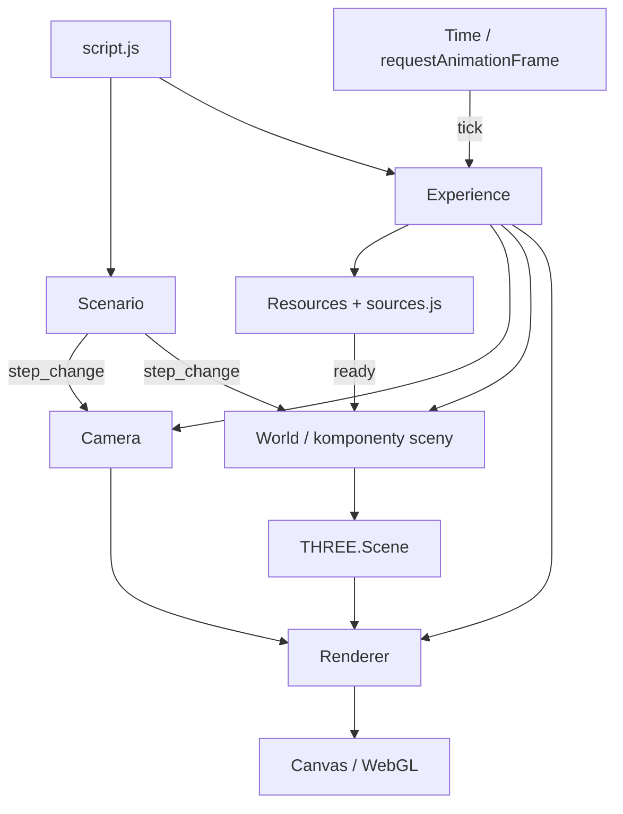

# POC renderowania grafiki 3D w JavaScript

Przeglądarkowy proof of concept renderowania 3D zbudowany w Three.js.
Aplikacja łączy graf sceny, animację, importowane modele, efekty proceduralne,
postprocessing i wideo w jednym środowisku JavaScript.

Sceny demonstracyjne służą do sprawdzania tych mechanizmów. Ich zachowanie
wynika z konfiguracji etapów, komponentów sceny i wspólnej pętli aktualizacji.
Aplikacja działa po stronie przeglądarki; do uruchomienia wystarcza serwer
plików statycznych.

## Stos technologiczny

Wersje bibliotek odpowiadają `package.json`; zależności pośrednie są zapisane
w `package-lock.json`.

| Technologia | Zastosowanie |
| --- | --- |
| JavaScript, ES modules | Klasy komponentów, konfiguracja scen, zdarzenia i logika animacji; bez frameworka UI. |
| Three.js `0.158.0` | Graf sceny, kamera perspektywiczna, geometrie, materiały, tekstury, raycasting i animacje modeli. |
| WebGL i GLSL | Renderowanie na GPU, własne shadery oraz modyfikacje shaderów materiałów Three.js. |
| Dodatki Three.js | `OrbitControls`, loadery glTF/FBX/fontów, `TextGeometry`, `EffectComposer`, `UnrealBloomPass`. |
| Vite `8.3.4` | Serwer developerski, obsługa modułów i budowanie statycznej aplikacji. |
| lil-gui `0.19.1` | Panel do regulacji wybranych parametrów sceny w trakcie działania. |
| SimplexNoise | Lokalny skrypt globalny używany do deformowania geometrii na CPU. |
| Sharp `0.35.5` | Skalowanie i kodowanie tekstur używanych przez aplikację. |
| Node.js `node:test` i `node:assert` | Testy logiki animacji, scenariuszy, sterowania i zasobów. |
| HTML i CSS | Canvas, nawigacja, wskaźnik ładowania i elementy wideo. |

## Uruchomienie

Wymagany Node.js zgodny z `^20.19.0 || >=22.12.0`, npm i przeglądarka
obsługująca WebGL.

```bash
npm ci
npm run dev
```

Domyślny adres: [http://localhost:8080/](http://localhost:8080/).
Vite udostępnia serwer także w sieci lokalnej i domyślnie otwiera przeglądarkę.

| Komenda | Działanie |
| --- | --- |
| `npm run dev` | Uruchamia serwer developerski na porcie 8080. |
| `npm run build` | Buduje aplikację w `dist/` z gotowych zasobów. |
| `npm run preview` | Udostępnia build pod adresem `http://127.0.0.1:8080/`. |
| `npm test` | Uruchamia testy w Node.js, bez renderowania WebGL. |
| `npm run assets:optimize` | Generuje zoptymalizowane tekstury i wybrane pliki FBX z oryginałów. |
| `npm run assets:check` | Weryfikuje grafiki, ścieżki zasobów i zgodność zoptymalizowanych modeli. |

Przed uruchomieniem podglądu produkcyjnego zwolnij port 8080.
Konfiguracja Vite używa `src/` jako katalogu wejściowego, `static/` jako
katalogu publicznego oraz względnej bazy URL `./`. Katalog `dist/` można
umieścić na hostingu statycznym, także pod podścieżką. Build generuje mapy źródeł.

### GitHub Pages

Repozytorium: [mknieszner/3d-js](https://github.com/mknieszner/3d-js).
Aplikacja: [https://mknieszner.github.io/3d-js/](https://mknieszner.github.io/3d-js/).

Workflow `.github/workflows/deploy-pages.yml` publikuje aplikację po pushu
na `main`; można go również uruchomić ręcznie w GitHub Actions. W Node.js 24
instaluje zależności przez `npm ci`, uruchamia testy i walidację zasobów,
a następnie buduje aplikację poleceniem:

```bash
npm run build -- --base=/3d-js/
```

Parametr `--base` ustawia prefiks adresów w buildzie przeznaczonym dla tego
repozytorium. GitHub Pages otrzymuje wyłącznie zawartość `dist/`. Wdrożenie
korzysta z wbudowanego `GITHUB_TOKEN` i OIDC; nie wymaga osobistego tokenu
w plikach ani sekretach repozytorium.

### Sterowanie i parametry URL

Etapy przełącza się strzałkami klawiatury lub przyciskami `<` i `>`.
Parametry są odczytywane przy inicjalizacji strony.

| Parametr | Znaczenie |
| --- | --- |
| `page` | Początkowy indeks etapu w zakresie `0–23`, liczony od zera. Niepoprawna wartość wybiera etap `0`. |
| `controls=true` | Włącza ręczny obrót, przesuwanie i zoom kamery oraz śledzenie wybranego obiektu. Domyślnie wyłączone. |
| `camera` | Współczynnik wygładzania przejścia w etapach korzystających z `Debug.getCameraVelocity()`; domyślnie `0.3`. Nie jest globalną prędkością kamery. |
| `model` | Dzielnik czasu przekazywanego do `AnimationMixer`; domyślnie `2000`. Większa dodatnia wartość spowalnia animacje modeli. |
| `#debug` | Włącza panel lil-gui. |

Przykład do oglądania sceny i regulacji jej parametrów:
[scena z ręczną kamerą i panelem debug](http://localhost:8080/?page=10&controls=true#debug).
Parametry `camera` i `model` są pomocniczymi ustawieniami developerskimi
bez pełnej walidacji; należy podawać skończone wartości dodatnie.

## Organizacja kodu

```text
src/
  index.html                  Canvas, nawigacja i elementy wideo
  script.js                   Punkt wejścia i powiązanie aplikacji z DOM
  style.css                   Interfejs nakładany na canvas
  Experience/
    Experiance.js             Klasa Experience, inicjalizacja i cykl życia
    Camera.js                 Kamera i jej przejścia
    Renderer.js               WebGL oraz postprocessing
    sources.js                Manifest modeli, tekstur i fontów
    Scenario/                 Lista etapów i aktualny stan
    Utils/                    Zegar, zdarzenia, zasoby, rozmiar okna, wejście
    World/                    Komponenty budujące zawartość sceny
static/                       Zasoby dostarczane do przeglądarki
assets/originals/             Oryginały przetwarzanych zasobów
scripts/                      Optymalizacja i walidacja zasobów
tests/                        Testy logiki
.github/workflows/            Weryfikacja i publikacja w GitHub Pages
vite.config.js                Konfiguracja uruchomienia i budowania
```

Plik `Experiance.js` eksportuje klasę `Experience`.

## Architektura i przepływ wykonania

`Experience` jest singletonem i centralnym punktem dostępu do sceny, kamery,
renderera, zasobów, zegara i wejścia użytkownika. Komponenty pobierają te
zależności przez `Experience.INSTANCE`. Moduły korzystają z własnej klasy
`EventEmitter` do obsługi zdarzeń `ready`, `tick`, `resize` oraz `step_change`.



### Inicjalizacja i zasoby

`script.js` tworzy `Scenario`, a następnie `Experience` powiązane z
`canvas.webgl`. `Resources` odczytuje manifest `sources.js` i uruchamia
loadery bez sekwencyjnego oczekiwania na każdy plik. Faktyczna współbieżność
pobierania zależy od przeglądarki.

Zasoby trafiają do `resources.items` pod nazwami z manifestu. Po zakończeniu
wszystkich pozycji emitowane jest `Resources.READY_EVENT`. Wtedy `World`
tworzy obiekty sceny, a warstwa ładowania HTML zostaje usunięta. Zegar i renderer
są inicjalizowane wcześniej.

### Stan sceny opisany danymi

`Scenario` łączy tablice z `ScoresScenario.js` i `HistoryScenario.js`.
Przechowuje indeks `step` oraz konfigurację `stage`. Metody `next()`
i `prev()` wybierają sąsiedni etap i emitują `step_change`.

Etap określa m.in. docelowe położenie kamery, skale i widoczność obiektów,
oświetlenie, teksty oraz aktywny film. Komponenty reagują przez `setConfig()`
i dochodzą do stanu docelowego w kolejnych klatkach. Obiekty grafu sceny są
współdzielone między etapami i sterowane przez ich konfiguracje.

### Pętla animacji i czas

Jedna pętla `requestAnimationFrame` w `Time` wywołuje aktualizacje w kolejności:

```text
Camera.update → World.update → Raycaster.update → Renderer.update
```

`time.delta` i `time.elapsed` są wyrażone w milisekundach.
`time.frameScale = delta / (1000 / 60)` skaluje przyrosty obrotu i ruchu
względem 60 FPS. Płynne przejścia używają `time.damping(alpha)`, które
przelicza współczynnik interpolacji na bieżący odstęp między klatkami:

```text
damping(alpha) = 1 - (1 - alpha) ^ frameScale
```

Zegar pomija czas spędzony w ukrytej karcie i ogranicza pojedynczy krok do
100 ms. Przy długotrwałej wydajności poniżej 10 FPS czas animacji
postępuje wolniej niż czas rzeczywisty. Renderowanie następuje po aktualizacji
transformacji obiektów.

## Zastosowane techniki grafiki 3D

### Graf sceny, transformacje i interakcja

Obiekty składają się z `Mesh`, geometrii, materiałów oraz nadrzędnych
`THREE.Group`. Pozwala to oddzielić ruch całego obiektu od obrotu jego
powierzchni, podpisu i efektów dodatkowych. Podpisy z `TextGeometry` oraz
płaszczyzny pomocnicze mogą kopiować orientację kamery, aby pozostać czytelne.

Kamera perspektywiczna obsługuje interpolowane przejścia, ruch po zadanej
trajektorii i śledzenie obiektu. `OrbitControls` zapewnia opcjonalne sterowanie
ręczne. `Mouse` przelicza położenie kursora na współrzędne znormalizowane,
a `Raycaster` sprawdza przecięcia z wybranymi obiektami i pomocniczymi
płaszczyznami interakcji.

### Materiały i selektywny bloom

Scena łączy `MeshBasicMaterial` dla elementów niezależnych od oświetlenia
z `MeshStandardMaterial` dla powierzchni reagujących na światło. Używane są
mapy koloru, normalnych, AO, metaliczności i szorstkości, przezroczystość,
wireframe oraz mieszanie addytywne.

`Renderer` konfiguruje antyaliasing, wyjście sRGB i tone mapping Cineon.
Efekt bloom jest selektywny i wykorzystuje dwa `EffectComposer`:

1. Obiekty bez flagi `corpo_bloomed` otrzymują tymczasowo czarny materiał.
2. `RenderPass` i `UnrealBloomPass` zapisują poświatę do tekstury.
3. Oryginalne materiały są przywracane.
4. Drugi composer renderuje scenę, dodaje teksturę bloom przez `ShaderPass`
   i kieruje wynik przez `OutputPass` na ekran.

Flaga jest właściwością obiektu sceny. Ten mechanizm pozwala wyróżniać wybrane
powierzchnie i efekty bez obejmowania bloomem wszystkich materiałów.

### Efekty proceduralne na CPU i GPU

`DefaultNucleus` deformuje wierzchołki sfery na CPU za pomocą szumu
SimplexNoise. Aktualizuje bufor pozycji geometrii i oznacza go jako
`needsUpdate`, aby dane trafiły do GPU.

`StellarActivity` realizuje efekty powierzchni i korony w GLSL:

- poświata jest billboardem z dwóch trójkątów, ustawianym w stronę kamery;
- wzór jest liczony w lokalnych współrzędnych obiektu i podąża za jego obrotem;
- szum przestrzenny steruje rozmieszczeniem i odchyleniem smug, a funkcje
  wygładzające i zanik wykładniczy kontrolują ich przezroczystość;
- łuki mają punkty zakotwiczenia rzutowane z powierzchni obiektu;
- `onBeforeCompile` dodaje emisję do istniejącego materiału sfery;
- mieszanie addytywne i `depthWrite: false` pozwalają nakładać efekt poświaty.

Efekt nie wymaga dodatkowych obrazów. Opcja `{plasma: true}` w konfiguracji
`DefaultPlanet` włącza smugi, łuki i emisję powierzchni; pozostałe obiekty
korzystają z samej korony. Flaga kompilacji `STELLAR_PLASMA` pomija kod tych
dodatków dla prostszego wariantu. Zasięg i tempo efektu są ustawiane stałymi
w `StellarActivity.js`, niezależnie od transformacji obiektu.

### Trajektorie, geometria buforowa i cząstki

`EllipticalOrbit` opisuje elipsę przez mimośród, nachylenie, orientację i fazę.
Równanie Keplera jest rozwiązywane iteracyjnie, dzięki czemu ruch przyspiesza
bliżej ogniska. Kwaternion ustawia płaszczyznę orbity w przestrzeni.

Ta sama reprezentacja trajektorii służy do obliczania pozycji obiektu oraz
próbkowania `OrbitLine`, więc narysowana ścieżka odpowiada ruchowi.
`DottedOrbit` używa `THREE.Points` do rysowania punktowanych torów.
Współdzielone tory mają przesunięte próbki, aby zachować widoczność kilku kolorów.

`Stars` przechowuje pozycje cząstek w `BufferGeometry` i tablicach typowanych.
Aktualizuje ich współrzędne oraz ponownie wykorzystuje punkty po zakończeniu
przelotu. Wiele cząstek jest renderowanych jako jeden obiekt `THREE.Points`.

### Modele, animacje szkieletowe i wideo

`Resources` obsługuje modele glTF i FBX, tekstury, cubemapy oraz fonty JSON/TTF.
Klipy animacji modeli są uruchamiane przez `AnimationMixer` i aktualizowane
z jednego zegara w `World.update()`. `Actor` przypisuje modelom materiały
aplikacji, łącząc przezroczystą powierzchnię z warstwą wireframe.

`VideoPlane` zamienia element HTML `video` w `THREE.VideoTexture`
i nakłada go na geometrię w scenie. Elementy wideo początkowo mają
`preload="none"` i `data-src`. Po załadowaniu zasobów 3D najbliższy przyszły
film otrzymuje źródło i `preload="auto"`, także gdy poprzedza go kilka etapów
bez wideo. Wejście w film przygotowuje następny film, bez uruchamiania go.
Zmiana etapu zatrzymuje pozostałe filmy; ponowne wejście zachowuje przypisane
źródło i `VideoTexture`. Przy blokadzie autoplay odtwarzanie jest ponawiane
po interakcji użytkownika.

## Zarządzanie zasobami i wydajność

Ekran ładowania znika dopiero po przygotowaniu tekstur na GPU, kompilacji
shaderów (również ukrytych modeli i wariantów oświetlenia kokpitu/wyników)
oraz próbnym renderowaniu modeli do bufora poza ekranem. Nawigacja jest
w tym czasie wstrzymana. Start może potrwać dłużej, ale pierwsze pokazanie
modelu nie musi wykonywać tych operacji podczas przejścia.

`StagePreloader` przygotowuje geometrię napisów i jej bufory na GPU dla dwóch następnych etapów,
zachowując bieżący i jeden poprzedni. `GeometryCache` współdzieli geometrię
identycznych napisów; zasoby poza tym oknem są zwalniane. Przygotowanie działa
po jednym napisie w wolnym czasie przeglądarki (`requestIdleCallback`, z
zastępczym `setTimeout`), a szybka nawigacja anuluje poprzednią kolejkę.
Panele wyników są wykorzystywane ponownie, a niezmieniona konfiguracja
nie przebudowuje wykresów. Bardzo szybkie przejścia mogą wyprzedzić kolejkę;
wtedy potrzebny napis powstaje przy wejściu. Buforowanie filmów pozostaje
w gestii przeglądarki i nie gwarantuje pobrania całego pliku przed odtwarzaniem.

Zasoby mają oddzielną reprezentację źródłową i wykonawczą:

| Lokalizacja | Rola |
| --- | --- |
| `assets/originals/` | Wersjonowane pliki źródłowe dla procesu przygotowania zasobów; poza katalogiem publicznym. |
| `static/` | Modele, tekstury, fonty i filmy dostarczane do przeglądarki. |
| `scripts/texture-settings.mjs` | Deklaracje formatów, rozmiarów i ścieżek wejścia oraz wyjścia dla przetwarzanych tekstur. |
| `scripts/optimize-textures.mjs` | Przetwarzanie plików źródłowych do postaci używanej przez aplikację. |

Proces przygotowania zasobów korzysta z plików źródłowych przy każdym
uruchomieniu. Mapy koloru objęte tym procesem mają format WebP/JPEG,
jakość 85 i rozmiar do 2048 px. Wybrane mapy danych mają format PNG
bez redukcji palety i rozmiar do 1024 px.

Modele FBX obsługiwane przez `Actor` zawierają geometrię, szkielet i klipy
animacji. Ich wygląd określają materiały tworzone w aplikacji. Skrypt
`strip-fbx-textures.mjs` przygotowuje te modele bez osadzonych obrazów
i powiązań tekstur; obsługuje binarny format FBX 7700.

Przygotowanie i walidacja zasobów są osobnymi poleceniami npm. Build korzysta
z plików w `static/`. Repozytorium zawiera pliki źródłowe, zasoby wykonawcze
oraz skrypty ich przetwarzania.

Koszt działania aplikacji zależy od kilku niezależnych mechanizmów:

- kompresja obrazów ogranicza transfer, a rozdzielczość wpływa na rozmiar
  zdekodowanych tekstur;
- `devicePixelRatio` jest ograniczony do 2, co wyznacza maksymalną gęstość
  pikseli renderowanego obrazu;
- nieaktywne grupy korzystają z flagi `visible`, aby wyłączyć ich renderowanie;
- efekty proceduralne wykorzystują obliczenia shaderów zamiast tekstur animacji;
- źródła filmów są aktywowane przez scenariusz, a wskaźnik ładowania działa w CSS.

## Weryfikacja

`npm test` uruchamia testy logiki bez przeglądarki:

| Plik w `tests/` | Sprawdzany mechanizm |
| --- | --- |
| `animation-timing.test.mjs` | Ruch i interpolacja przy różnych FPS, nieregularnych klatkach oraz powrocie z ukrytej karty. |
| `orbits.test.mjs` | Zgodność rysowanej trajektorii z pozycją obiektu, orientacja, tempo ruchu i widoczność. |
| `camera-controls.test.mjs` | Włączanie ręcznego sterowania parametrem URL i działanie przejść kamery. |
| `scenario-page.test.mjs` | Wybór etapu, granice nawigacji i niepoprawne parametry `page`. |
| `deferred-video.test.mjs` | Wcześniejsze ładowanie najbliższego filmu, ponowne odtwarzanie i obsługa blokady autoplay. |
| `stage-preloader.test.mjs` | Przygotowanie etapów, anulowanie kolejki, ograniczenie cache, współdzielenie geometrii i przygotowanie buforów GPU. |

`assets:check` sprawdza zgodność geometrii, danych szkieletu i ścieżek animacji
zasobów wykonawczych z plikami źródłowymi, używając rzeczywistego `FBXLoader`.
Weryfikuje również brak żądań tekstur przy wczytywaniu wybranych modeli FBX,
formaty i wymiary obrazów oraz istnienie plików z manifestu.

Weryfikacja renderowania obejmuje kontrolę wyglądu sceny, przejść i komunikatów
WebGL w przeglądarce. `npm run build` sprawdza zbudowanie modułów;
kompilacja GLSL odbywa się podczas renderowania.

## Konwencje implementacji

| Element | Sposób powiązania z aplikacją |
| --- | --- |
| Zasób | Nazwa, typ i ścieżka w `sources.js`; dostęp przez `resources.items`. |
| Komponent sceny | Inicjalizacja w `World`, obiekt lub grupa w `THREE.Scene`, aktualizacja przez `World.update()`. |
| Stan komponentu | Pola w konfiguracji etapu odczytywane w `setConfig()` i wartości docelowe używane podczas animacji. |
| Animacja | Wspólny zegar `Time`, przyrosty zależne od `frameScale` lub funkcje `elapsed`. |
| Efekt GPU | Własny `ShaderMaterial` albo rozszerzenie materiału przez `onBeforeCompile`. |
| Udział w bloomie | Flaga `corpo_bloomed` na renderowanym obiekcie. |

## Ograniczenia implementacji

Architektura POC jest dostosowana do jednej sceny i jednej instancji aplikacji:

- Wszystkie zasoby z manifestu są inicjalnie ładowane do wspólnego etapu
  gotowości. Odroczone pobieranie dotyczy filmów. Loadery nie mają wspólnej
  obsługi błędów ani ponawiania; brak pliku może zatrzymać zakończenie loadera.
- Singleton i globalne `window.experience` oraz `window.scenario` wiążą moduły
  z jedną instancją aplikacji. `destroy()` zwalnia część zasobów, ale nie stanowi
  pełnego mechanizmu wielokrotnego montowania i odmontowywania sceny.
- Renderowanie jest wieloprzebiegowe. `Renderer.update()` wykonuje także
  bezpośredni render przed composerami. Deformacje na CPU i część aktualizacji
  obiektów wykonują pracę mimo ich niewidoczności.
- Konfiguracje etapów są zwykłymi obiektami JavaScript bez walidowanego schematu.
  Niektóre moduły zależą od konkretnej hierarchii zaimportowanych modeli.
- SimplexNoise jest dostarczany jako klasyczny skrypt. Build zgłasza ostrzeżenie
  o tym skrypcie oraz o rozmiarze głównego pakietu JavaScript.
- `ActorHologram.js` znajduje się poza aktywnym grafem importów i odwołuje się
  do brakującego `HolographicMaterial.js`.
